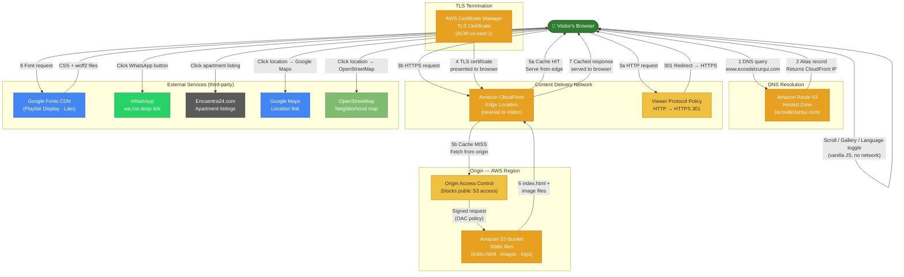

# Ecos del Zurquí – Landing Page

**Live site:** [https://www.ecosdelzurqui.com](https://www.ecosdelzurqui.com)

---

## Table of Contents

1. [Overview](#overview)
2. [Why a single file?](#why-a-single-file)
3. [HTML technologies](#html-technologies)
4. [Page components](#page-components)
5. [AWS infrastructure](#aws-infrastructure)
6. [Domain anatomy](#domain-anatomy)
7. [TLS/SSL certificate](#tlsssl-certificate)
8. [Redirection methods](#redirection-methods)
9. [Data flow diagram](#data-flow-diagram)

---

## Overview

Static bilingual (Spanish / English) landing page for the **Ecos del Zurquí** residential complex in Tibás, San José, Costa Rica. It showcases 3 apartments and the main house, common amenities, location, and a WhatsApp contact button. Zero backend — the entire site is a single `index.html` file served from AWS.

---

## Why a single file?

| Concern | Rationale |
|---|---|
| **Deployment simplicity** | One `aws s3 sync` or file upload is all it takes. No build step, no bundler, no CI pipeline needed. |
| **Zero dependencies** | No `node_modules`, no package manager, no framework version drift. The file works as-is in any browser from a USB stick or S3. |
| **Performance** | The browser makes exactly **one** HTML request. CSS and JS are already in the same payload — no render-blocking extra fetches for stylesheets or script bundles. |
| **Maintainability at this scale** | With fewer than 810 lines of HTML, ~220 lines of CSS, and ~160 lines of JS, splitting into separate files would add complexity with no gain. |
| **Hosting cost** | S3 charges per-request. Fewer files = fewer requests per page load. |

Images are the only separate assets (organized in subfolders per unit), because they are binary blobs that would bloat the HTML file and cannot be inlined efficiently.

---

## HTML technologies

### Document structure
- **HTML5** semantic elements: `<header>`, `<nav>`, `<section>`, `<article>`, `<footer>`
- `lang="es"` on `<html>` (updated dynamically to `"en"` by JavaScript on language switch)
- `<meta name="viewport">` for responsive scaling on mobile devices
- `<meta name="description">` for SEO

### Fonts
- **Google Fonts CDN** loads two typefaces via a single `<link>` tag:
  - `Playfair Display` (serif) — headings and decorative text
  - `Lato` (sans-serif) — body text and UI labels
- The `display=swap` parameter prevents invisible text during font load (FOIT)

### CSS
| Feature | Used for |
|---|---|
| **CSS Custom Properties** (`--var`) | Brand palette (greens, gold, cream) and reusable shadows/radii defined once in `:root` |
| **CSS Grid** | `auto-fit` + `minmax` responsive apartment card and amenity grids |
| **Flexbox** | Header, nav, contact buttons, location grid |
| **`clamp()`** | Fluid typography that scales between min/max without media query breakpoints |
| **`aspect-ratio`** | Gallery containers maintain 4:3 (apartments) and 16:10 (amenities) regardless of width |
| **`backdrop-filter: blur()`** | Frosted-glass sticky header effect |
| **CSS transitions & transforms** | Card hover lift, hero image zoom, language-class toggling (`.es`/`.en` display switching) |
| **`scroll-behavior: smooth`** | Native browser smooth scrolling to anchor sections |
| **Media queries** | Single breakpoint at 820 px (tablet/mobile) and 480 px (small phone) |

### JavaScript (vanilla, no frameworks)
| Feature | Implementation |
|---|---|
| **Gallery engine** | Each gallery is registered in a `galleries{}` map. Slides move via `translateX(-N*100%)` on a flex track. Dots are generated programmatically. |
| **Event delegation** | A single `click` listener on `document` handles all arrow buttons, dots, and gallery-to-lightbox clicks — no per-element listeners. |
| **Auto-advance** | `setInterval` runs every 5 000 ms per gallery, staggered by 833 ms each so they don't all advance simultaneously. Paused while lightbox is open. |
| **Lightbox** | Full-screen overlay with opacity fade, keyboard navigation (← → Esc), and touch swipe (threshold 50 px). Scroll locked on `<body>` while open. |
| **Language toggle** | Adds/removes `lang-en` class on `<body>`. CSS rules hide `.es` / show `.en` spans globally — no DOM manipulation per element. Also updates `<html lang>` and `document.title`. |
| **Scroll shadow** | Passive `scroll` listener toggles `.scrolled` class on the header above 40 px scroll depth. |
| **Passive listeners** | `scroll` and `touchstart`/`touchend` events use `{ passive: true }` to avoid blocking the browser's scroll thread. |

### Image formats
- **AVIF** — modern format with ~50% smaller file size vs JPEG at equivalent quality; used for all listing photos sourced from Encuentra24
- **JPEG** — fallback format for WhatsApp photos taken directly from the phone
- `loading="lazy"` on all gallery images defers fetching until the image is near the viewport

---

## Page components

```
┌─────────────────────────────────────────┐
│  HEADER  (sticky)                       │
│  Logo · Nav links · ES/EN toggle        │
├─────────────────────────────────────────┤
│  HERO  (88 vh)                          │
│  Background photo + overlay gradient    │
│  H1 title · tagline · CTA button        │
├─────────────────────────────────────────┤
│  ABOUT                                  │
│  Descriptive copy (bilingual)           │
├─────────────────────────────────────────┤
│  APARTMENTS  (auto-fit grid)            │
│  ┌────────┐ ┌────────┐ ┌────────┐ ┌──┐ │
│  │ Apt 1  │ │ Apt 2  │ │ Apt 3  │ │🏠│ │
│  │gallery │ │gallery │ │gallery │ │  │ │
│  │tags    │ │tags    │ │tags    │ │  │ │
│  │CTA btn │ │CTA btn │ │CTA btn │ │  │ │
│  └────────┘ └────────┘ └────────┘ └──┘ │
├─────────────────────────────────────────┤
│  AMENITIES  (dark green bg)             │
│  Photo cards: Rancho · Café · Parking   │
│  Icon cards: Security · Internet        │
├─────────────────────────────────────────┤
│  LOCATION                               │
│  Text + clickable location items        │
│  → Muni Tibás website                   │
│  → Cerro Zurquí lightbox gallery        │
│  → Google Maps route to city center     │
│  → OpenStreetMap neighborhood view      │
├─────────────────────────────────────────┤
│  CONTACT  (dark green bg)               │
│  WhatsApp deep-link button              │
├─────────────────────────────────────────┤
│  FOOTER                                 │
└─────────────────────────────────────────┘
       [LIGHTBOX overlay — fixed, z:9999]
```

### Lightbox
A single shared `<div id="lightbox">` is reused for every gallery. When a gallery or location card is clicked, the lightbox is populated with that gallery's image array and displayed via `display:flex`. This avoids one lightbox per gallery.

---

## AWS infrastructure

The site uses a fully **serverless static hosting** stack. There is no server process running — AWS manages all compute.

| Service | Role |
|---|---|
| **Amazon S3** | Origin storage for all static files (`index.html`, images, logo) |
| **Amazon CloudFront** | Global CDN distribution — caches files at edge locations worldwide, terminates HTTPS, enforces redirect policies |
| **AWS Certificate Manager (ACM)** | Provisions and auto-renews the TLS certificate for `ecosdelzurqui.com` and `www.ecosdelzurqui.com` |
| **Amazon Route 53** | Authoritative DNS — routes `www.ecosdelzurqui.com` to the CloudFront distribution via an **Alias record** |

### Amazon S3
- The bucket holds the site files organized in the same folder structure as this repo
- **Static website hosting** is enabled on the bucket, but direct public access is blocked
- CloudFront is the only allowed reader via an **Origin Access Control (OAC)** policy attached to the bucket
- This means files are never accessible directly via the S3 URL — only through CloudFront

### Amazon CloudFront
- A single **distribution** is configured with the S3 bucket as its origin
- **Alternate domain names (CNAMEs):** `www.ecosdelzurqui.com` and `ecosdelzurqui.com`
- **Default root object:** `index.html` — so visiting `/` serves the HTML without needing to specify the filename
- **Cache behaviors:** HTML files have a short TTL (to pick up updates quickly); images have a long TTL (they are content-addressed by name and rarely change)
- **Viewer Protocol Policy:** `Redirect HTTP to HTTPS` — all plain-HTTP requests are 301-redirected to HTTPS at the edge, before reaching the origin

### AWS Certificate Manager (ACM)
- The certificate must be provisioned in **us-east-1 (N. Virginia)** regardless of where other resources live — this is a CloudFront requirement
- The certificate covers both the apex domain (`ecosdelzurqui.com`) and the `www` subdomain using **Subject Alternative Names (SAN)**
- Validation is done via **DNS validation**: ACM generates a CNAME record that is added to Route 53 to prove domain ownership; ACM then auto-renews the certificate silently before expiration

### Amazon Route 53
- Hosts the **hosted zone** for `ecosdelzurqui.com`
- Two records point to the CloudFront distribution:
  - `www.ecosdelzurqui.com` → **Alias A record** → CloudFront distribution domain
  - `ecosdelzurqui.com` (apex) → **Alias A record** → CloudFront distribution domain (or an S3 redirect bucket)
- Alias records are preferred over CNAME for the apex because CNAME at the root violates DNS standards (RFC 1912)

---

## Domain anatomy

```
https://www.ecosdelzurqui.com/
│        │   │             │ └─ Path (/ = root, serves index.html)
│        │   │             └─── TLD  — Top-Level Domain (.com = commercial)
│        │   └───────────────── SLD  — Second-Level Domain (ecosdelzurqui = brand name)
│        └───────────────────── Subdomain (www = World Wide Web conventional prefix)
└────────────────────────────── Scheme (https = HTTP over TLS)
```

The registrar (where the domain was purchased) delegates DNS authority to Route 53 by pointing the domain's **Name Server (NS)** records to the four Route 53 name servers assigned to the hosted zone.

---

## TLS/SSL certificate

- **Standard:** TLS 1.2 / TLS 1.3 (CloudFront enforces a minimum of TLS 1.2)
- **Issuer:** Amazon Trust Services (Amazon's own CA, trusted by all major browsers)
- **Type:** Domain Validated (DV) — confirms domain ownership only, no organization identity
- **Validation method:** DNS validation via CNAME record in Route 53 (managed automatically)
- **Renewal:** Automatic — ACM renews 60 days before expiry with no manual intervention
- **Coverage:** `ecosdelzurqui.com` + `www.ecosdelzurqui.com` (SAN certificate)
- **HSTS:** CloudFront can be configured to add `Strict-Transport-Security` response headers, which instruct browsers to never attempt plain HTTP for the domain

---

## Redirection methods

| Redirect | Mechanism | Where it happens |
|---|---|---|
| `http://` → `https://` | CloudFront **Viewer Protocol Policy = Redirect HTTP to HTTPS** — issues a 301 response at the nearest edge node | CloudFront edge |
| `ecosdelzurqui.com` → `www.ecosdelzurqui.com` | A secondary S3 bucket (no content) configured for **website redirect** to `www.ecosdelzurqui.com`, fronted by its own CloudFront distribution pointing at that bucket | S3 + CloudFront |
| `/` → `index.html` | CloudFront **Default Root Object = index.html** — translates bare-path requests to the actual file key in S3 | CloudFront |
| In-page anchors | HTML anchor links (`href="#apartments"`) combined with `scroll-behavior: smooth` in CSS | Browser |

---

## Data flow diagram



### Step-by-step explanation

1. **DNS query** — The browser asks Route 53 to resolve `www.ecosdelzurqui.com`. Route 53 returns the CloudFront distribution's IP address via an Alias record (no CNAME latency penalty).

2. **TLS handshake** — CloudFront presents the ACM certificate. The browser validates it against Amazon's CA and establishes an encrypted TLS session. All subsequent communication is HTTPS.

3. **HTTP → HTTPS redirect** — Any visitor who types `http://` is immediately 301-redirected to `https://` by CloudFront's Viewer Protocol Policy before the request ever reaches the origin.

4. **Cache check at edge** — CloudFront checks whether the requested object is already cached at the nearest edge location. If it is a cache hit, the file is served from RAM at the edge node — typical latency under 20 ms globally.

5. **Origin fetch (cache miss)** — On a cache miss (first request, or after TTL expiry), CloudFront fetches the file from S3 using a signed request authorized by the Origin Access Control policy. S3 serves the file; CloudFront caches it and forwards it to the visitor.

6. **Browser rendering** — The browser receives `index.html`, parses the inline CSS and JS, and fires off two extra requests: one to Google Fonts CDN for the web fonts, and lazy-loaded image requests for the visible gallery photos.

7. **User interactions** — Gallery navigation, lightbox, and language toggling are handled entirely by vanilla JavaScript in memory — zero additional network requests. Clicking apartment CTAs opens Encuentra24. WhatsApp button opens the native WhatsApp app via a `wa.me` deep link. Location items open Google Maps and OpenStreetMap in new tabs.
